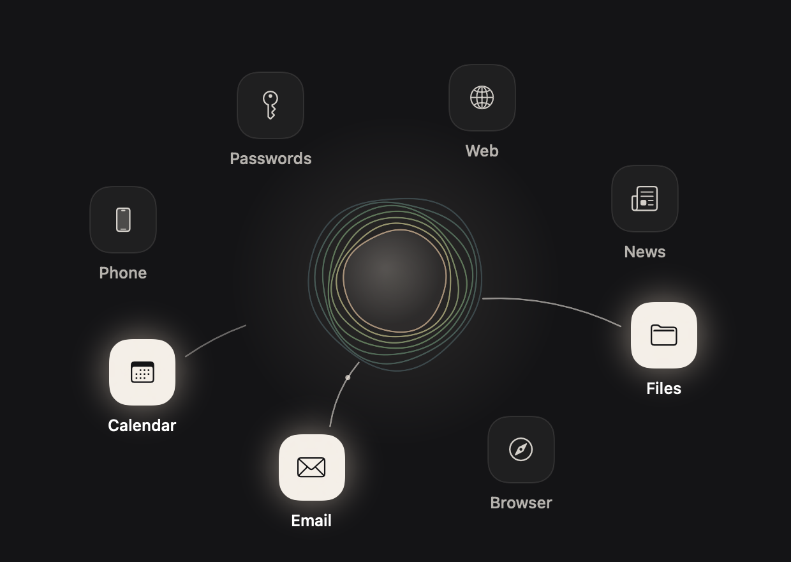

# One

**A personal AI assistant that lives on your Mac, for people who have never opened a terminal.**

**Not a developer?** Go to [donnadieu.github.io/one](https://donnadieu.github.io/one) and press Download.

You download it, you open it, and it talks you through the rest. It sets itself up, asks which AI you already pay for, learns your name, and shows you everything it can reach from your Mac. Then it works for you: your files, your browser, your email, your calendar, the web. It always asks before it does anything that matters.



> Status: early test build (0.9.63). It runs end to end on Apple Silicon Macs. Passwords (KeePass), email and calendar through the accounts already on your Mac and your own Chrome now work; Phone and News are not built yet, but you can build your own with the assistant (experimental). See [Roadmap](#roadmap).

---

## Why this exists

Personal AI agents can already do remarkable things: tidy a folder, sign in to a site, watch a price, read fifty emails and tell you who is waiting on you. But getting one running still means a terminal, API keys, config files and a chat box that gives you no idea what to type.

When the iPhone arrived, every phone had a keyboard. The answer wasn't a better keyboard; it was removing it. One tries to do the same for assistants. The "keyboard" here is the setup friction and the empty chat box. So:

- **One button to start.** Everything after that is a conversation the assistant leads, out loud.
- **It lives on your Mac, not in a cloud.** It uses your own browser, already signed in, so websites treat it like you instead of blocking it as a bot. It can reach your files, but only the folders you allow.
- **Bring the AI you already pay for.** ChatGPT, Claude, Grok or OpenRouter. Switch any time. Nobody locks you to one model.
- **Its memory is yours.** Plain files on your Mac, organised in rooms. Switch AIs and it still remembers you.
- **A human stays in the loop.** Buying, paying, sending or deleting always waits for your yes.
- **Honest about its limits.** If your Mac is closed or off, so is the assistant. It tells you that up front.

This is a personal project, not a company. It is built for me, my friends and anyone who wants an assistant that is theirs.

## What it does today

1. **Welcome.** Four spoken lines surface on screen: who it is, where it lives, that it asks first, and that it's off when your Mac is off.
2. **Sets itself up.** On first launch it installs its own private copy of its engine (about 80 seconds, no terminal, no questions). It never touches your shell files or any other install.
3. **Pick your AI.** Sign in with ChatGPT, Claude, Grok or OpenRouter through each provider's own sign-in page. If your plan doesn't allow a model, it quietly tries the next one.
4. **Names.** "What would you like to call me? And what should I call you?"
5. **Memory and rooms.** Everything starts in a personal room. If part of your life needs different rules (your job, a business, something just for you), it gets its own room, kept separate.
6. **The world.** A short spoken tour of everything it can reach, then you tap what you want connected.
7. **Passwords and backup.** Where to find logins (your password manager, Keychain, or ask each time), and an optional copy of your memory to iCloud Drive.
8. **Home.** A greeting, the assistant itself with every helper around it as a small orb (no limit: more helpers wrap onto more orbits; orange = needs your yes or done and not opened yet), the answer to your latest request, and the ask box (+ for a file, photo, screenshot or folder; mic to talk). The **Ready for you** sidebar (files your assistant made) collapses to a thin strip.
9. **Helpers.** Anything that takes real work (looking things up, browsing, comparing, making a file, watching a price) goes to helpers that run in the background, several at once when a job has separate parts. The assistant stays free to talk.
10. **Talk.** Hold a shortcut anywhere on your Mac to speak; let go to send. A small orb floats on screen when the window is closed and hides when the window is open. Closing the window tucks it into the orb; only Quit ends One.
11. **Voice everywhere.** Replies, helper results and finished routines are read aloud even when the window is closed, unless muted. Press Esc, or click the orb, while One is talking to stop the voice for that reply only.
12. **Brain and voice.** Tap the assistant's name: pick Smartest, Balanced or Fastest (or any OpenRouter model), and a female or male voice with three styles each. Tap one to hear it. To rename the assistant, just ask it.
13. **Connections.** The same floating world as setup. Connected tiles are tied to the assistant by a thread; tap one to change it or disconnect.
    - **Passwords:** KeePass (1Password and Bitwarden through the engine's vault). Logins are filled without the model ever seeing the password.
    - **Email and Calendar:** the accounts already on your Mac (Gmail, Outlook, iCloud, Yahoo). No account yet? One opens the right Settings page, tells you what to click, and notices by itself when you're done. The assistant drafts; you always press Send.
    - **Browser:** your own Chrome, already signed in. Connections › Browser › Chrome › Connect copies its sign-ins into a hidden browser One keeps for the assistant (your Chrome stays open and is never touched, no window pops up; the copy refreshes whenever that browser starts, and Disconnect deletes it). Arc and Safari aren't built yet.
    - **Basecamp:** ask your assistant "connect my Basecamp". It gives you a link and a code; you approve on your phone or computer. It reads your projects, to-dos, cards and messages freely, and asks before posting, commenting or changing anything.
    - **Something else…:** on every tile, plus its own tile. The assistant asks what you use, builds the connection with you, tests it in front of you and only then adds it, tagged **Experimental**.
    - **Goal first:** whenever you ask to connect something, the assistant first asks what you want to happen (for example "text me" or "read my texts"), says it back, then picks a way that actually does that and tells you up front what it can't do.
14. **Rooms.** A live map of your rooms (personal, work, a shared room with a partner). Rooms can be shared through iCloud Drive or kept in sync with a private GitHub repo.

## How it is built

One is deliberately small: **one Swift file** and a build script. No Xcode project.

| Piece | What it is |
|---|---|
| **Face** | A SwiftUI app (`Sources/main.swift`), built with `swiftc` for Apple Silicon, macOS 14+. |
| **Engine** | [Hermes Agent](https://github.com/NousResearch/hermes-agent) by Nous Research (MIT). It brings model routing to any provider, tools (files, browser, web, scheduling), memory and secret stores. One never shows it to the user. |
| **Talking to the engine** | Hermes's ACP adapter: JSON-RPC over stdio (`initialize`, `session/new`, `session/prompt`). Replies stream in; permission requests become "needs your yes" cards. |
| **Isolation** | One runs its own Hermes in `~/Library/Application Support/One`, with its own `HERMES_HOME`, so it never mixes with another Hermes on the same Mac. |
| **First-launch install** | Hermes's official installer, bundled in the app and run non-interactively with a scratch `HOME`, so nothing outside One's folder changes. |
| **Folder lock** | The engine runs inside a macOS sandbox profile (`sandbox-exec`). Your home folder is closed except One's own data, your memory and the folders you approve. This is enforced by the Mac, not by the model's good behaviour. |
| **Sign-in** | Hermes's own OAuth/device-code flows (`hermes auth add <provider>`), so any provider Hermes supports becomes available to One. |
| **Memory** | Rooms built from a "brain starter" template set: plain Markdown files, one folder per room, with rules for what each room may hold. Writes inside your memory need no yes; anything outside still asks. |
| **Voice** | [Kokoro](https://github.com/thewh1teagle/kokoro-onnx) (open source, default voice `af_heart`, six to choose from), running on the Mac: no account, no cost per word, nothing leaves the Mac. Downloaded once after the engine (`tools/install_voice.sh`, ~350 MB) and run by `tools/speak.py`. It speaks setup lines with the user's and assistant's names, and reads replies aloud sentence by sentence. Setup lines are also pre-recorded in the same voice as a fallback until the download finishes. |
| **Connections** | Passwords use a KeePass vault backend for Hermes (`tools/overlay/agent/vault_backends/keepass.py`, via `keepassxc-cli`); the master password can come from the macOS Keychain and is held in memory only. One copies the KeePass backend into its engine after every install, so it survives engine updates. Each connection opens only the paths it needs in the sandbox. Connections built with the assistant are saved as skills under `skills/my-connections/` and listed in `connections.json`. |
| **Skills that ship with One** | Repo folder `skills/<category>/<name>/SKILL.md` (today: `productivity/basecamp-connect`, `productivity/connect-goal-first`). `build.sh` bundles it; One copies each skill into its engine after install and at every launch. A skill changed on the Mac is never overwritten; an untouched copy is updated when a newer one ships (tracked by hash). Checked by `--test-skills` in preflight. |
| **Updates** | `Updater` checks GitHub releases every 15 minutes, at launch and when the Mac wakes (with `If-None-Match`, backing off on errors and rate limits). A newer release with `One.zip` is announced once per version, even with the window closed: a macOS notification, an orb note and a spoken line (unless muted). Clicking the notification opens the update card; nothing installs without a tap. Checked by `--test-updates` (fake list via `ONE_RELEASES_URL`) in preflight. |
| **Routines** | Hermes scheduled jobs. One watches their results and reads new ones aloud. |
| **Design** | The world screen was designed in Claude Design and rebuilt natively: a living set of soft rings for the assistant, upright tiles drifting around it, links that draw in when you tap. |

### Build it

Requirements: an Apple Silicon Mac, macOS 14+, Xcode Command Line Tools (`xcode-select --install`).

```bash
./build.sh             # builds build/app.noindex/One.app (.noindex: Spotlight won't list it as another One)
./build.sh --install   # also copies it to ~/Applications
./build.sh --package   # builds build/One.dmg and build/One.zip (the updater's download)
```

Optional: `BRAIN_STARTER=/path/to/brain-starter` to bundle memory room templates.

Developer flags on the app binary. Every test flag (`--selftest`, `--install-test`, `--test-*`) runs only from a test copy, `APP=$(tools/test-copy.sh <name>)`, never as your real One: your files and settings are never touched by a test (`One --test-production` checks it in preflight). `--selftest` (runs the engine against a throwaway home; needs `OPENROUTER_API_KEY`), `--install-test` (fresh-user install into `ONE_SUPPORT_DIR`), `--test-updates` (a new version is announced once; same, older or zip-less never; fake list via `ONE_RELEASES_URL`, needs `ONE_SUPPORT_DIR` set to an empty folder), `--test-restart` (a changed folder list restarts the engine once under the new lock, an unchanged one never; needs `ONE_SUPPORT_DIR` set to an empty folder), `--test-helpers` (helpers cut off by a restart are picked back up, ones stopped with Stop never; needs `ONE_SUPPORT_DIR`), `--test-voice` (stopping the voice for one reply never mutes and the next reply speaks; stand-in voice, needs `ONE_SUPPORT_DIR`), `--test-skills` (shipped skills reach a fresh home and never overwrite an edited copy; needs `ONE_SUPPORT_DIR` set to an empty folder), `--render-world <prefix>` (renders the world, Connections, rooms and the brain and voice card to PNGs), `--say "text"` (speaks a line through the voice engine), `--signin-probe <provider>`, `--reset`.

To re-record the fallback voice lines: edit `voice/lines.json`, then `python3 tools/render_voice.py <dir with kokoro-v1.0.onnx and voices-v1.0.bin>` (needs `kokoro-onnx`, `soundfile`, `ffmpeg`).

## What is enforced, and what relies on the assistant

Enforced by the Mac or by One's code (the assistant can't get around it):
- **Folder lock:** the engine can only open One's own data, your memory and the folders you approved.
- **A newly allowed folder takes effect by itself:** when the folder list changes, One waits until nothing is mid-reply, restarts its engine under the new lock, reopens the same conversation and lets the assistant carry on.
- **Email can't be sent:** One only creates drafts; you press Send.
- **No browser window pops up on your screen:** helpers and routines browse in hidden browsers. A command that would open, show or drive a visible browser (`open -a`, AppleScript, a browser started without `--headless`) is blocked and logged, and the assistant asks you in plain words: "I need to open <browser> to <reason>. Can I?". Only your yes in One's chat lets that one window through, once. The engine's own browser tools are kept hidden, and the code/passkey hand-off window only shows when you tap Show the window. (Limit: it reads commands before they run, so a program that opens a browser by itself without saying so can still get through.)
- **A robot check stops the job and asks you:** when a page in the hidden browser stays on a Cloudflare / "verify you are human" check, One asks by itself ("Can I show you the window?", with Yes, show it / Not now) and turns the helper that was browsing orange. Only your yes shows that one window; after you tick it, the helper carries on with the job as asked. A helper whose reply skips that ask still ends on it. (Sign-ins, codes and passkeys inside a job are asked the same way, but that part relies on the assistant, below.)
- **Passwords stay out of the chat:** logins are filled from your password manager without the model seeing them.
- **Updates and the engine version:** One installs the Hermes version it was tested with.
- **Shared rooms:** a new file you add to a shared room (or a change to one of its skills) that copies lines from your private rooms is held back on your Mac, and One tells you. You can still say "share it anyway". A shared room's skills are never handed to the engine, so a private job can't edit them.
- **Tell me when I learn:** when your assistant saves a new skill (a recipe, so it doesn't have to figure the job out again), One says so in one line after the job, with Undo. Small fixes to a skill are never announced. After a long job where nothing was saved, One asks once, about two minutes later, whether to remember how it did it, and never again for that kind of job after a No.
- **Routines in one place:** the Routines button shows every scheduled job and watcher on a 24-hour dial around your assistant (done, still to come, or didn't finish and why), every skill as a star, and lets you Run now, Pause or ask about one. Pausing and running go through the engine's own scheduler; nothing is deleted from there.
- **Experimental connections** ("Something else…") stay switched off in the engine until their test has passed.
- **Helpers never get lost:** One keeps a trail of what each helper did (`helpers/<id>.md` in One's folder). If One restarts or updates while a helper is working, it picks the helper back up by itself (3 at a time, at most twice per helper), hands it that trail and tells you. Being picked back up never counts as a yes. Helpers you stop with the Stop button stay stopped.
- **Work keeps going when you walk away:** while your assistant is replying, a helper is working (or waits to be picked back up after a restart) or a routine is running, One keeps the Mac from falling asleep on its own, plugged in or on battery (on battery that uses some charge). The screen still turns off as usual. One lets go the moment nothing is working, so the Mac then sleeps as usual (`pmset -g assertions` shows "One is finishing 2 helpers" while it holds). Limits: closing the lid or choosing Sleep still puts the Mac to sleep and pauses the work, and a routine can't wake a sleeping Mac.
- **Skills One ships never overwrite yours:** if you or your assistant changed one, the new version is skipped for that skill.

Relies on the assistant following its instructions (usually works, not guaranteed):
- Asking before paying, posting or deleting on a website, or before posting or changing anything in Basecamp (Basecamp only offers full access).
- Keeping each private room's notes out of your other private rooms (shared rooms are checked in code).
- A tested experimental connection doing only what it says.
- Stopping and asking when it hits a sign-in, a code, a passkey or a button only you can press, instead of skipping that part or doing the job another way (the rule is in its instructions and on every helper turn; robot checks are caught in code, above).
- Saving a skill you said yes to into the right room (One checks the file is there before it says so), and not saving recipes for a kind of job you said no to (if it does anyway, One undoes it by itself).

## Privacy

- Your files, memory and settings stay on your Mac.
- What you ask is sent to the AI provider you chose, under your own account.
- One has no server, no analytics and no account of its own.

## Roadmap

- News as a built-in connection.
- A "Today" page: what it did, what needs your yes, what it noticed.
- It reaches out first ("your flight dropped $80, book it?").
- Your phone: a small companion app for iPhone and Android, so you can reach your assistant away from the Mac.
- Signed and notarised builds.
- Maybe later: an optional hosted version for people who don't want to keep a Mac on. One stays free and open source.

## Contributing

Ideas, bug reports and pull requests are welcome. See [CONTRIBUTING.md](CONTRIBUTING.md). The bar for every change is the same question: does this make it simpler for someone who is not technical?

## Credits

- [Hermes Agent](https://github.com/NousResearch/hermes-agent) by Nous Research, the engine underneath.
- Voice by [Kokoro](https://huggingface.co/hexgrad/Kokoro-82M) (Apache 2.0). World screen first designed with Claude Design.

## License

[MIT](LICENSE)
